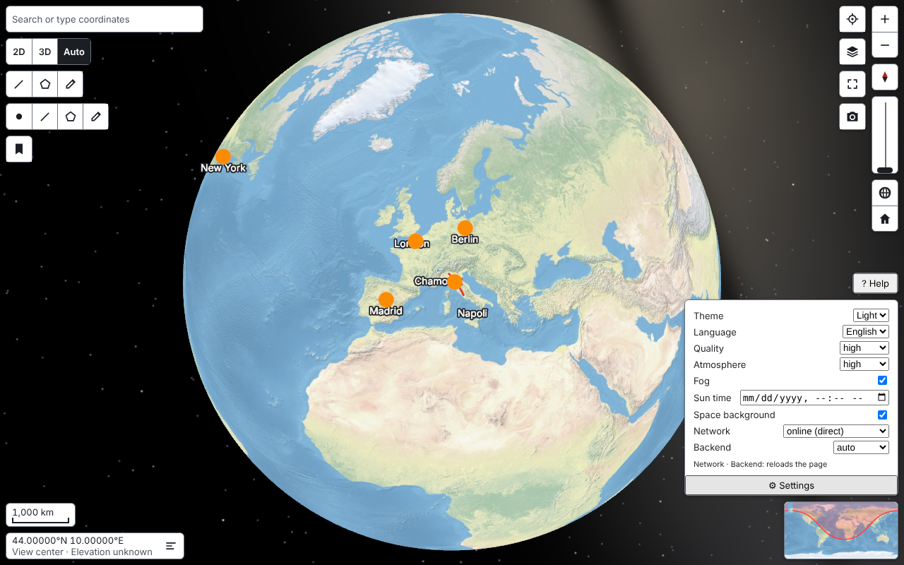

# VibeGlobe

A generic, modular web engine that renders an interactive 3D globe and map — globe when zoomed out, flat 2D map at mid zoom, oblique 3D view up close — built for fluidity and zero visual glitches. TypeScript, WebGPU with automatic WebGL2 fallback, framework-agnostic core with Vue 3 and Web Component adapters.

Status: early development. See `npm run status` for progress against the feature list.

## Quick start

Requires Node.js 22.18 or later.

```sh
./init.sh          # install, build, start the playground, run the tests
npm run dev        # playground at http://localhost:5173
npm run status     # feature-list progress
```

## The playground

`npm run dev` opens the showcase at http://localhost:5173: every control of `@vibeglobe/ui` (search with typed
coordinates and a demo place list, compass, zoom, tilt, 2D / 3D / Auto, reset to globe and home, fullscreen,
coordinate and elevation readout, scale bar, measurement, drawing, layer switcher, saved views, screenshot,
geolocation, minimap, attribution), a settings panel (theme, language, quality, atmosphere, fog, sun time, space
background, network mode, backend), demo data layers (clustered markers, a polygon, a line, labels), the best data
built locally by the dataset pipeline (otherwise Natural Earth) and a help overlay of the gestures. `?ui=0` hides the
controls; the test scenarios keep their own parameters ([apps/playground/CLAUDE.md](apps/playground/CLAUDE.md)).



## Documentation

- [PLAN.md](PLAN.md): the owner's master brief.
- [docs/plan/](docs/plan/README.md): technical plan (architecture, APIs, milestones, targets and testing).
- [docs/adr/](docs/adr/README.md): architecture decisions.
- [docs/research/](docs/research/README.md): research survey.
- [progress.md](progress.md): session log.
- [CONTRIBUTING.md](CONTRIBUTING.md): how to contribute, with the [Developer Certificate of Origin](DCO.md) sign-off.
- [SECURITY.md](SECURITY.md): how to report a vulnerability.
- [CODE_OF_CONDUCT.md](CODE_OF_CONDUCT.md): community standards.

## Packages

The packages will be published on the public npm registry under the [`@vibeglobe`](https://www.npmjs.com/org/vibeglobe) organization, for example `@vibeglobe/core` and `@vibeglobe/vue`. Nothing is published before the first release.

## Licensing

VibeGlobe is open source under the [Mozilla Public License 2.0](LICENSE.md) (SPDX `MPL-2.0`), copyright Simone Recchia. There is no separate commercial license.

- **Any use, commercial included:** you may use, change and distribute VibeGlobe, alone or inside larger works under other licenses, at no cost.
- **Changes to VibeGlobe's own files stay open:** if you distribute a modified VibeGlobe file, its source is available under the MPL 2.0, and its license notice is kept. Your own files that only use VibeGlobe may stay under any license.

Third-party components keep their own licenses, listed in [THIRD_PARTY_NOTICES.md](THIRD_PARTY_NOTICES.md). Map data shown by the engine is licensed by its providers; the default datasets and their attribution rules are documented with the data pipeline.

External contributions carry a [Developer Certificate of Origin](DCO.md) sign-off on every commit.

## Contact

Security reports and code-of-conduct reports: recchia.sim@gmail.com (see [SECURITY.md](SECURITY.md) and [CODE_OF_CONDUCT.md](CODE_OF_CONDUCT.md)).
