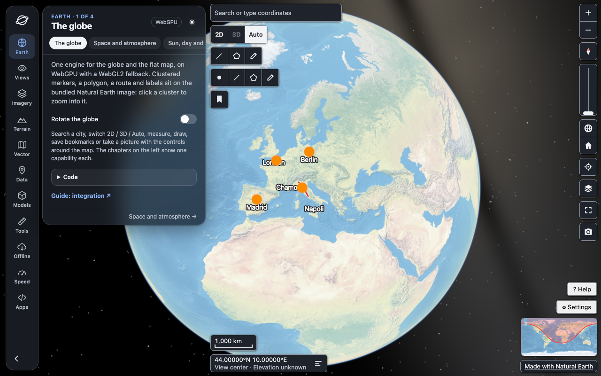

# VibeGlobe

A TypeScript web engine that draws an interactive 3D globe and 2D map: a globe when zoomed out, a flat map at mid
zoom, an oblique 3D view up close. WebGPU with an automatic WebGL2 fallback, built to run smoothly on weak hardware.
Imagery, terrain, vector tiles, glTF models, application data, offline packages and ready-made controls, in one ESM
package, `vibeglobe`, with a subpath for each part. Framework-agnostic, with Vue 3 and Web Component adapters.

**For AI agents:** [llms.txt](llms.txt) is the index of the guides by task. Installed, the index and the guides
matching the version are in `node_modules/vibeglobe/` (`llms.txt`, `docs/guides/`).



## The smallest globe

```ts
import { xyzImagery } from 'vibeglobe/sources';
import { createVibeGlobe } from 'vibeglobe';

const { globe } = await createVibeGlobe(document.getElementById('map') as HTMLElement, {
  tiles: { imagery: [xyzImagery({ id: 'imagery', url: 'https://tiles.example.com/{z}/{x}/{y}.jpg', maxLevel: 18 })] },
  view: { longitudeDeg: 12.5, latitudeDeg: 41.9, zoom: 5 },
});
```

VibeGlobe ships no map and no provider: it takes the application's services, a `TileService` (required), a terrain
and a `GeocoderService` (optional), and turns off what a missing optional service would serve. Any provider, tiles of
your own included, plugs in through the generic sources ([services guide](docs/guides/services.md)). The
[integration guide](docs/guides/integration.md) assembles the engine piece by piece, with Vue, Nuxt and the Web
Component.

## What is in it

One package, one install; the bundler takes only the subpaths an application imports.

| Subpath                   | What it does                                                                          |
| ------------------------- | ------------------------------------------------------------------------------------- |
| `vibeglobe`               | `createVibeGlobe`: the globe in one call with the application's services              |
| `vibeglobe/core`          | `createGlobe`, camera, tiling, scheduling, cache, events, geodesy, service interfaces |
| `vibeglobe/renderer`      | The WebGPU and WebGL2 backends; glTF, vector tile and starfield renderers by subpath  |
| `vibeglobe/worker`        | The worker pool that decodes tiles and models off the main thread                     |
| `vibeglobe/sources`       | Generic imagery, terrain, vector and 3D source adapters, provider profiles            |
| `vibeglobe/controls`      | Mouse, touch, trackpad and keyboard navigation                                        |
| `vibeglobe/layers`        | Application data: markers, labels, lines, polygons, models, vector tile styles        |
| `vibeglobe/models`        | glTF 2.0 and GLB parsing and validation, Draco and meshopt decoding                   |
| `vibeglobe/offline`       | Network modes, the browser tile cache, offline packages                               |
| `vibeglobe/ui`            | Optional ready-made controls, themes and translations                                 |
| `vibeglobe/gis`           | Coordinates, reference systems, measurement, view state, panel detection              |
| `vibeglobe/quality`       | Quality presets and the adaptive frame-time governor                                  |
| `vibeglobe/vue`           | Vue 3 components and composables, SSR-safe                                            |
| `vibeglobe/web-component` | The `<vibe-globe>` custom element                                                     |
| `vibeglobe/tools`         | Command-line data pipeline and offline package builder                                |

Each part's README (`packages/<name>/README.md`) lists its entry points and pitfalls.

## Install

```sh
npm install vibeglobe
```

One package holds the whole engine; `vue` 3.5 or later is needed only for `vibeglobe/vue`. Node.js 22.18 or later for
the tools (`npx vibeglobe-data`). Before a version is on the npm registry, build its tarball from a tag
(`npm ci && npm run build && npm run release:pack`) and install it from the file.

## Licensing

VibeGlobe is open source under the [Mozilla Public License 2.0](LICENSE.md) (SPDX `MPL-2.0`), copyright Simone
Recchia. There is no separate commercial license.

- **Any use, commercial included:** you may use, change and distribute VibeGlobe, alone or inside larger works under
  other licenses, at no cost.
- **Changes to VibeGlobe's own files stay open:** if you distribute a modified VibeGlobe file, its source is available
  under the MPL 2.0, and its license notice is kept. Your own files that only use VibeGlobe may stay under any
  license.

Third-party components keep their own licenses, listed in [THIRD_PARTY_NOTICES.md](THIRD_PARTY_NOTICES.md). Map data
is not part of VibeGlobe: it is licensed by its providers, and the application that shows it chooses its sources,
holds their keys and keeps to their terms ([provider profiles](docs/guides/sources.md#provider-profiles)). The default
datasets and their attribution rules are in [data licenses](docs/data-licenses.md).

## Working on VibeGlobe

```sh
./init.sh          # install, build, start the playground, run the tests
npm run dev        # the playground at http://localhost:5173: every control, settings and demo data
npm run status     # feature-list progress
```

- [CLAUDE.md](CLAUDE.md): how the library is developed, its rules and commands.
- [PLAN.md](PLAN.md): the owner's brief; [docs/internal/](docs/internal/plan/README.md): plans, architecture
  decisions, research, bug and test logs.
- [CONTRIBUTING.md](CONTRIBUTING.md): how to contribute, with the [Developer Certificate of Origin](DCO.md) sign-off.
- [SECURITY.md](SECURITY.md) and [CODE_OF_CONDUCT.md](CODE_OF_CONDUCT.md): reports go to recchia.sim@gmail.com.
